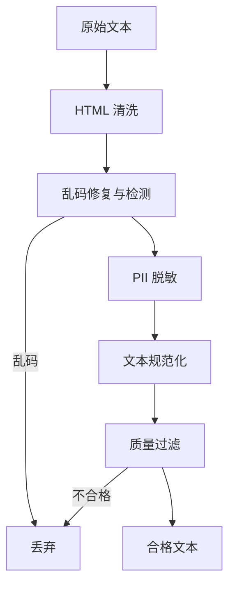
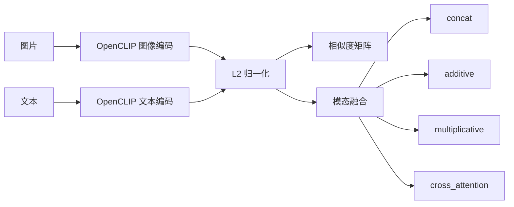

# 训练数据处理工具链

一个面向大模型训练数据的模块化处理工具链，覆盖数据清洗、数据去重和多模态特征对齐与融合。项目采用 Python 包与命令行脚本分层设计，既可一键运行完整流水线，也可单独调用各个处理模块。

## 功能概览

| 模块 | 能力 | 实现位置 |
| --- | --- | --- |
| 数据清洗 | HTML 标签清洗、乱码修复、PII 脱敏、文本规范化、质量过滤 | `src/training_data_processing/cleaning` |
| 数据去重 | MD5 精确去重、MinHash + LSH 近似去重、TF-IDF 语义去重 | `src/training_data_processing/dedup` |
| 多模态处理 | OpenCLIP 图文特征提取、模态对齐、四种融合方式、交叉注意力 | `src/training_data_processing/multimodal` |
| 数据读写 | JSONL 记录读取与写出，保留原始元数据 | `src/training_data_processing/io.py` |
| 命令行入口 | 下载、清洗、去重、多模态处理、一键运行 | `scripts` |

## 技术栈

- Python 3.10+
- PyTorch、torchvision
- OpenCLIP、Pillow
- scikit-learn、NumPy
- BeautifulSoup4、lxml、ftfy、langdetect
- tqdm、matplotlib

## 项目结构

```text
training-data-processing/
├── pyproject.toml
├── requirements.txt
├── uv.lock
├── Makefile
├── README.md
├── .gitignore
│
├── data/
│   ├── raw/raw.jsonl
│   └── processed/
│       ├── cleaned.jsonl
│       └── deduplicated.jsonl
│
├── src/training_data_processing/
│   ├── __init__.py
│   ├── io.py
│   ├── cleaning/
│   │   ├── html_cleaner.py
│   │   ├── garbled_cleaner.py
│   │   ├── sensitive_cleaner.py
│   │   ├── normalizer.py
│   │   ├── quality_filter.py
│   │   ├── pipeline.py
│   │   └── stats.py
│   ├── dedup/
│   │   ├── minhash.py
│   │   ├── lsh.py
│   │   ├── text_deduplicator.py
│   │   ├── semantic_deduplicator.py
│   │   └── pipeline.py
│   └── multimodal/
│       ├── cross_attention.py
│       └── processor.py
│
├── scripts/
│   ├── download_data.py
│   ├── run_cleaning.py
│   ├── run_dedup.py
│   ├── run_multimodal.py
│   └── run_all.sh
│
└── outputs/
    ├── reports/
    │   ├── cleaning_report.json
    │   └── dedup_report.json
    ├── figures/similarity_matrix.png
    └── features/multimodal_fusion.npz
```

## 分层设计

| 层级 | 目录 | 职责 |
| --- | --- | --- |
| 入口层 | `scripts/` | 解析命令行参数，调用核心模块，保存结果 |
| 业务层 | `src/training_data_processing/cleaning` | 文本清洗、脱敏、规范化、质量过滤 |
| 业务层 | `src/training_data_processing/dedup` | 精确去重、近似去重、语义去重 |
| 业务层 | `src/training_data_processing/multimodal` | 图文特征提取、对齐、融合、可视化 |
| 基础层 | `src/training_data_processing/io.py` | JSONL 读写 |
| 数据层 | `data/` | 原始数据、清洗结果、去重结果 |
| 产出层 | `outputs/` | 统计报告、图片、特征文件 |

核心业务代码不依赖命令行参数，入口脚本也不实现具体算法。这样可以单独调用算法，也方便替换输入输出方式。

## 数据格式

输入和输出均采用 JSONL，每行一个 JSON 对象：

```json
{"id": "doc_001", "source": "news_crawl", "language_hint": "zh", "text": "待处理文本"}
```

| 字段 | 类型 | 说明 |
| --- | --- | --- |
| `id` | string | 文档唯一标识 |
| `source` | string | 数据来源 |
| `language_hint` | string | 语言提示 |
| `text` | string | 原始或处理后的文本 |

清洗和去重过程会保留这些元数据，只更新 `text` 字段。

## 安装

### 使用 uv（推荐）

项目已提供 `uv.lock`，可以直接创建环境并安装锁定版本：

```bash
uv sync
```

如果本机没有 uv，可先安装：

```bash
pip install uv
```

或：

```bash
curl -LsSf https://astral.sh/uv/install.sh | sh
```

`uv.lock` 当前使用华为云 PyPI 镜像解析。如果网络可以直接访问 PyPI，可重新生成锁文件：

```bash
uv lock --default-index https://pypi.org/simple
```

### 使用 pip

```bash
python3 -m venv .venv
source .venv/bin/activate
pip install -r requirements.txt
pip install -e .
```

### 模型权重

多模态模块使用 OpenCLIP ViT-B-32。首次运行会下载预训练权重。网络受限时可设置镜像：

```bash
export HF_ENDPOINT=https://hf-mirror.com
```

## 快速开始

一键运行完整流水线：

```bash
bash scripts/run_all.sh
```

使用 uv：

```bash
uv run bash scripts/run_all.sh
```

使用 Makefile：

```bash
make all
```

分步运行：

```bash
python scripts/run_cleaning.py
python scripts/run_dedup.py
python scripts/run_multimodal.py
```

## 使用说明

### 1. 准备数据

仓库已包含 `data/raw/raw.jsonl`。如需重新下载，可指定数据地址：

```bash
python scripts/download_data.py --url <数据地址>
```

也可以通过环境变量指定：

```bash
export TRAINING_DATA_URL=<数据地址>
python scripts/download_data.py
```

如果目标文件已存在，脚本会直接跳过下载。

### 2. 数据清洗

```bash
python scripts/run_cleaning.py
```

默认读取 `data/raw/raw.jsonl`，输出 `data/processed/cleaned.jsonl` 和 `outputs/reports/cleaning_report.json`。

可用参数：

| 参数 | 默认值 | 说明 |
| --- | --- | --- |
| `--input` | `data/raw/raw.jsonl` | 输入 JSONL |
| `--output` | `data/processed/cleaned.jsonl` | 输出 JSONL |
| `--report` | `outputs/reports/cleaning_report.json` | 清洗报告 |
| `--min-length` | `20` | 清洗后文本最小长度 |
| `--max-dup-char` | `0.4` | 最大重复 bigram 比例 |
| `--mask-mode` | `mask` | PII 处理方式：`replace` 或 `mask` |
| `--language` | 无 | 可选的目标语言过滤，如 `zh` |

### 3. 数据去重

```bash
python scripts/run_dedup.py
```

默认读取清洗结果，输出 `data/processed/deduplicated.jsonl` 和 `outputs/reports/dedup_report.json`。

可用参数：

| 参数 | 默认值 | 说明 |
| --- | --- | --- |
| `--input` | `data/processed/cleaned.jsonl` | 输入 JSONL |
| `--output` | `data/processed/deduplicated.jsonl` | 输出 JSONL |
| `--report` | `outputs/reports/dedup_report.json` | 去重报告 |
| `--text-threshold` | `0.5` | MinHash Jaccard 阈值 |
| `--semantic-threshold` | `0.5` | TF-IDF 余弦相似度阈值 |
| `--no-semantic` | 关闭 | 跳过语义去重阶段 |

### 4. 多模态处理

```bash
python scripts/run_multimodal.py
```

默认使用 OpenCLIP `ViT-B-32` 和 `laion2b_s34b_b79k` 权重，生成示例图片与文本，完成模态对齐和四种融合。

可用参数：

| 参数 | 默认值 | 说明 |
| --- | --- | --- |
| `--model-name` | `ViT-B-32` | OpenCLIP 模型名称 |
| `--pretrained` | `laion2b_s34b_b79k` | 预训练权重标签 |
| `--device` | 自动 | `cpu`、`cuda` 或自动检测 |
| `--output-dir` | `outputs` | 输出根目录 |
| `--seed` | `42` | 随机图片生成种子 |
| `--hf-endpoint` | 环境变量或镜像 | Hugging Face 下载地址 |

## 处理流程

### 数据清洗



| 步骤 | 组件 | 主要工作 |
| --- | --- | --- |
| HTML 清洗 | `HTMLCleaner` | 移除 script/style/nav 等标签，块级标签转换行，行内标签去壳，解码 HTML 实体 |
| 乱码修复 | `GarbledTextCleaner` | 修复 mojibake，移除零宽字符和控制字符，执行 NFC 规范化，检测不可打印字符和连续重复字符 |
| PII 脱敏 | `SensitiveDataCleaner` | 识别手机号、固定电话、邮箱、IP、身份证、银行卡、信用代码、密码，支持占位符替换和星号掩码 |
| 文本规范化 | `TextNormalizer` | 全角转半角，统一引号和破折号，压缩空白 |
| 质量过滤 | `QualityFilter` | 检查长度、字母比例、特殊符号比例、重复行、重复 bigram 和语言 |

`DataCleaningPipeline` 提供三个入口：

- `clean_single(text)`：处理单条文本
- `clean_batch(texts)`：处理纯文本列表
- `clean_records(records)`：处理带元数据的记录并保留原字段

### 数据去重


| 阶段 | 组件 | 说明 |
| --- | --- | --- |
| 精确去重 | `PipelineDeduplicator.exact_dedup` | 对 `text.strip()` 计算 MD5，移除完全相同的内容 |
| 近似去重 | `MinHasher` + `LSHIndex` | 将文本切成字符 n-gram，计算 MinHash 签名，通过 band 分桶减少候选对数量 |
| 语义去重 | `SemanticDeduplicator` | 默认使用 TF-IDF 向量和余弦相似度，也支持 Transformer 编码后端 |

### 多模态处理



`CrossAttentionFusion` 先以图像为 query、文本为 key/value 做一次交叉注意力，再以文本为 query、图像为 key/value 做一次交叉注意力，两次结果按 `0.7 / 0.3` 加权，并使用残差连接和 LayerNorm。

`MultimodalProcessor` 提供：

- `extract_image_features()`：提取并归一化图像特征
- `extract_text_features()`：提取并归一化文本特征
- `align_modalities()`：计算图文相似度矩阵
- `multimodal_fusion()`：执行指定融合方式
- `visualize_similarity()`：保存相似度热力图
- `save_features()`：保存特征和融合结果

## 输出文件

| 文件 | 说明 |
| --- | --- |
| `data/processed/cleaned.jsonl` | 清洗后的 JSONL，保留原始 `id`、`source`、`language_hint` |
| `data/processed/deduplicated.jsonl` | 去重后的 JSONL |
| `outputs/reports/cleaning_report.json` | 文档总数、保留数、移除原因、PII 命中次数 |
| `outputs/reports/dedup_report.json` | 精确去重、MinHash、语义去重各阶段的数量与移除比例 |
| `outputs/figures/similarity_matrix.png` | 图文相似度矩阵热力图 |
| `outputs/features/multimodal_fusion.npz` | 图像特征、文本特征、相似度矩阵和四种融合特征 |

`.npz` 中包含以下数组：

| 键 | 形状 | 说明 |
| --- | --- | --- |
| `image_features` | `(1, 512)` | 图像特征 |
| `text_features` | `(1, 512)` | 文本特征 |
| `similarity_matrix` | `(3, 3)` | 3 张图片与 3 条文本的相似度 |
| `concat` | `(1, 1024)` | 拼接融合特征 |
| `additive` | `(1, 512)` | 加法融合特征 |
| `multiplicative` | `(1, 512)` | 乘法融合特征 |
| `cross_attention` | `(1, 512)` | 交叉注意力融合特征 |

## 示例运行结果

数据清洗：

```text
总文档数:        32
保留文档数:      23
移除文档数:       9 (28.1%)
├─ 乱码过滤:      5
├─ 过短过滤:      0
└─ 质量过滤:      4
```

PII 脱敏统计：

```text
手机号     33 处
邮箱       19 处
身份证号   17 处
银行卡号   17 处
IP 地址    16 处
固定电话   13 处
密码        9 处
信用代码    3 处
```

数据去重：

```text
原始文档: 23
精确去重: 23 → 22
MinHash:  22 → 22
语义去重: 22 → 22
最终文档: 22
移除比例: 4.3%
```

多模态处理：

```text
相似度矩阵:
[[0.1434 0.1300 0.1714]
 [0.1409 0.1213 0.1782]
 [0.1475 0.1316 0.1783]]

concat           融合后特征维度: (1, 1024)
additive         融合后特征维度: (1, 512)
multiplicative   融合后特征维度: (1, 512)
cross_attention  融合后特征维度: (1, 512)

相似文本相似度: 0.784
不同文本相似度: 0.613
拼接融合中图像特征与原始图像特征相似度: 1.000
拼接融合中文本特征与原始文本特征相似度: 1.000
```

## 扩展指南

### 增加新的 PII 规则

向 `SensitiveDataCleaner` 传入 `extra_rules`：

```python
extra_rules = [("订单号", r"ORD\\d{12}", "[订单号]")]
```

### 使用 Transformer 语义去重

```python
SemanticDeduplicator(
    backend="transformer",
    model_name="sentence-transformers/all-MiniLM-L6-v2",
)
```

需要额外安装：

```bash
pip install transformers
```

### 替换多模态模型

```bash
python scripts/run_multimodal.py --model-name ViT-L-14 --pretrained laion2b_s32b_b82k
```

### 接入新的数据格式

在 `io.py` 中增加 Parquet、Arrow 或数据库读写函数，保持核心清洗、去重模块不变。

## 常见问题

### OpenCLIP 权重下载失败

设置镜像后重试：

```bash
export HF_ENDPOINT=https://hf-mirror.com
python scripts/run_multimodal.py
```

### uv sync 使用了华为云镜像

`uv.lock` 中的包地址指向华为云 PyPI 镜像。如果需要在其他网络环境使用，可以重新生成：

```bash
uv lock --default-index https://pypi.org/simple
uv sync
```

### 没有原始数据

仓库已经包含 `data/raw/raw.jsonl`。如果文件被删除，可通过 `--url` 或 `TRAINING_DATA_URL` 指定数据地址后重新下载。

### 只使用 CPU

多模态模块会自动检测 CUDA。也可以显式指定：

```bash
python scripts/run_multimodal.py --device cpu
```

### 图表无法显示

多模态模块使用 `Agg` 后端，图片直接保存到 `outputs/figures/similarity_matrix.png`，无需图形界面。

## 代码约定

- 核心逻辑集中在 `src/training_data_processing`，入口脚本只负责参数解析和流程编排。
- 每个组件职责单一，便于维护和替换。
- 代码使用类型标注和清晰命名，不添加注释。
- 结果文件统一写入 `outputs/`，中间数据统一写入 `data/processed/`。

